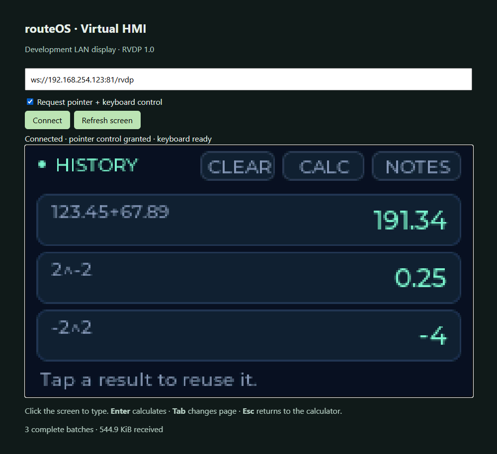
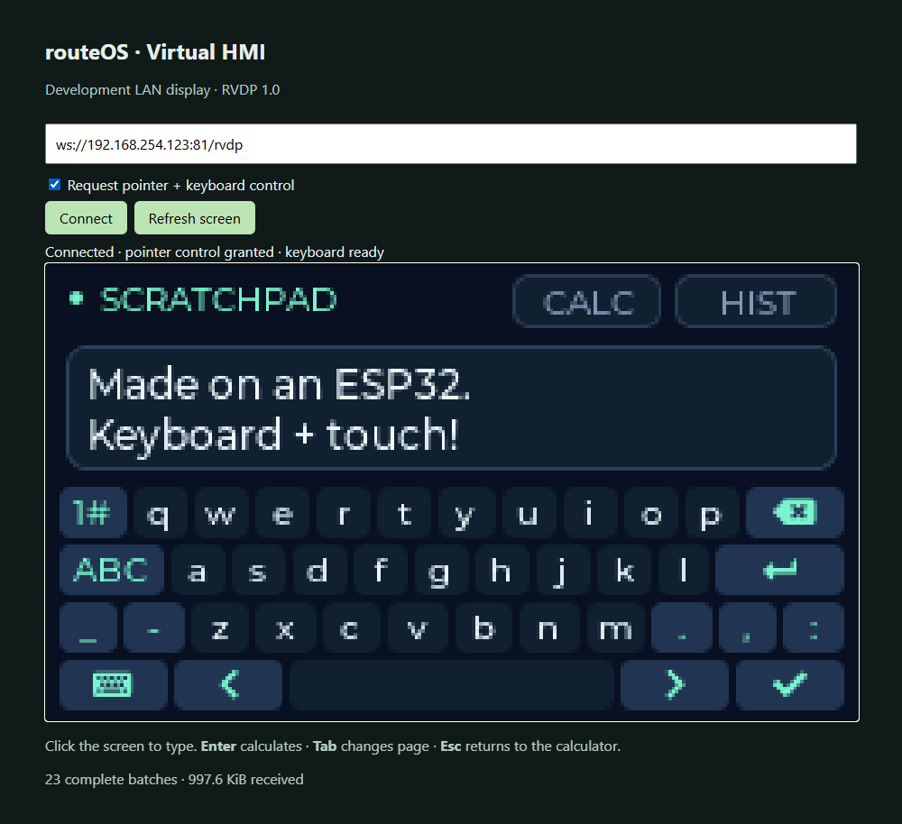

# routeOS

The isolated [Virtual HMI prototype](virtual-hmi/README.md) runs an EEZ Studio
LVGL 8.4 export headlessly and streams it over RVDP to a browser or iShareScreen.
Its firmware lives outside production `src/`; see [implementation results](docs/virtual-hmi.md).

The Orbit demo includes a 20-button calculator, reusable history, and a scratchpad
with on-screen and laptop keyboard input. It uses negotiated RVDP 1.1 keyboard
support while keeping RVDP 1.0 pointer compatibility. Open the layout in
[EEZ Studio](virtual-hmi/eez/routeos-hmi.eez-project); build and viewer instructions
are in the [Virtual HMI guide](virtual-hmi/README.md). To open either firmware in
Arduino IDE, see the [Arduino IDE guide](docs/arduino-ide-guide.md).

**Managed from Termz.** The Orbit firmware includes [routeOS Core](modules/routeos-core)
(`GET /api/capabilities`, plus token-protected driver management in a `--control`
build). [Termz](https://github.com/pointlessduffin-21/cubeterm) reads the board's chip,
flash, PSRAM and free memory, shows which [packages](docs/routeos-packages.md) fit it,
and installs sensor drivers and plugins over the network without reflashing. It also shows
the board's Wi-Fi signal and changes its network (undoing the change if the new network does not work), reads
its event log, and updates its firmware wirelessly with automatic rollback if the new firmware does not start; see
[routeOS management](docs/routeos-management.md). The catalog
is in [`marketplace/packages/`](marketplace/packages); RVDP and Tailscale are listed as
modules. Tailscale needs a board with PSRAM, so it is not available on the 4 MB lab
ESP32. The Core and the install flow have run on that lab board (see the status in the
packages guide); no real sensor has been connected to it yet.

<p align="center">
  
</p>
<p align="center">
  
  
</p>

*Actual ESP32-rendered pixels. The native session was captured through Qt's
offscreen platform; the browser captures show the live hardware viewer.*

**routeOS** is the embedded operating system for EcoRoute smart bin nodes — running on the ESP32-WROOM microcontroller and managing every aspect of the device: sensor I/O, WiFi/MQTT/BLE connectivity, captive portal provisioning, and persistent configuration.

It is architecturally comparable to Apple's **bridgeOS** — a dedicated OS running on a dedicated chip inside a larger system, handling specific I/O and communication functions the host never touches directly.

| | Apple bridgeOS | routeOS |
|---|---|---|
| **Host System** | MacBook Pro | Smart Waste Bin |
| **Processor** | T1/T2 Chip (ARM) | ESP32-WROOM (Xtensa Dual-Core @ 240 MHz) |
| **Base Kernel** | watchOS/iOS (stripped) | FreeRTOS (via ESP-IDF / Arduino) |
| **Local UI** | Touch Bar | Web Dashboard (HTTP captive portal) |
| **Communication** | Internal bus to macOS | MQTT + HTTP to cloud backend |
| **Provisioning** | Paired with macOS automatically | WiFi Direct (captive portal) + BLE GATT |
| **Discovery** | Automatic via internal bus | BLE scan / WiFi AP — always, hidden, or on-demand |
| **Manages** | Touch ID, SMC, audio, SSD, camera | Ultrasonic distance, IR lid, battery ADC, WiFi, MQTT |

---

## Repository Layout

```
routeOS/
  src/                     Production firmware — modular, BLE-enabled (v3.2.0-tc3)
    main.cpp               Core loop, WiFi/MQTT, web server, AP modes, power mgmt
    config.h               Pin assignments, BLE UUIDs, AP mode constants, timing
    config_manager.cpp/h   NVS persistent key-value storage
    sensor_reader.cpp/h    HC-SR04 ultrasonic + battery ADC with median filtering
    mqtt_client.cpp/h      MQTT telemetry publish wrapper
    http_client.cpp/h      HTTP POST telemetry + heartbeat to backend
    wifi_manager.cpp/h     WiFi STA mode connection management
    ble_provisioning.cpp/h BLE GATT server — mobile provisioning + AP control

  v4/                      ESP32 firmware variants
    docking-version/         Smart bin docking station firmware
    docking-version-tof/     Docking station with VL53L0X ToF sensor
    docking-version-tof-simulated/  ToF variant with simulated sensor output
    lid-version/             Lid-detect bin firmware (IR sensor variant)
    lid-version-simulated/   Lid variant with simulated sensor output

  tof-test/                Standalone VL53L0X I2C sensor test sketch
  simulator/               TypeScript firmware simulator for development without hardware
  dashboard/               routeOS fleet management page (React, used in EcoRoute web app)
  assets/                  Marketing and architecture images

  platformio.ini           PlatformIO build environments (esp32dev, webui, tof-test, tc2)
  serial-monitor.py        Python serial monitor with telemetry logging
  serial-monitor-app.py    Serial monitor variant
  serial-web.py            Web-based serial bridge
  start-bridge.sh/.bat     MQTT bridge startup scripts
  telemetry_sample.json    Example MQTT telemetry payload
```

---

## Hardware

### Target MCU
**ESP32-WROOM-32** — dual-core Xtensa LX6 @ 240 MHz, 4 MB Flash, 520 KB SRAM, integrated WiFi 802.11 b/g/n + Bluetooth 4.2 LE.

### Sensors

| Sensor | Model | GPIO | Function |
|--------|-------|------|----------|
| Ultrasonic Distance | HC-SR04 / RCWL-9610A | TRIG: 5, ECHO: 18 | Fill level via time-of-flight |
| IR Lid Detector | HW-201 | GPIO 4 | Lid open / closed state |
| Battery Voltage | ADC (2× 100 kΩ divider) | GPIO 34 (ADC1_CH6) | 2× 18650 Li-ion via TP4056 |
| ToF Distance (optional) | VL53L0X | I2C: SDA 21, SCL 22 | Precision fill-level (docking variant) |
| Status LED | Onboard | GPIO 2 | Visual state indicator |

---

## Connectivity

### WiFi Station (STA)
- Non-blocking connection with 15 s timeout
- Auto-reconnect every 30 s
- Credentials stored in NVS, configurable via captive portal or BLE

### Captive Portal (AP Mode)
Device runs a captive portal at `192.168.4.1`. SSID: `ecoroute-<device_code>`. Three broadcast modes:

| Mode | Behavior | Use Case |
|------|----------|----------|
| **Always** | AP always visible | Default for unconfigured / new devices |
| **Hidden** | SSID not broadcast | Provisioned devices — connect by typing SSID or via BLE |
| **On-Demand** | AP off by default; BLE enables it (5 min auto-timeout) | Production — zero idle radio until requested |

Mode persisted in NVS, controllable via BLE commands, REST API (`POST /api/ap-mode`), or mobile app.

### MQTT Telemetry
- Topic: `ecoroute/trash_can/<device_code>`
- One-shot publish-and-disconnect per cycle
- Default interval: 900 s (15 min), configurable

**Payload:**
```json
{
  "device_code": "ECO-BIN-001",
  "fill_level_percent": 72.5,
  "distance_cm": 27.5,
  "battery_voltage": 3.85,
  "signal_strength": -62,
  "lid_closed": true,
  "anomaly_flag": false,
  "firmware_version": "3.2.0-tc3"
}
```

### BLE Provisioning (GATT)
Mobile app discovers devices via `ECO-BIN-*` BLE advertisement, writes config directly to GATT characteristics, and sends a Save & Restart command. No WiFi connection required to provision.

**GATT Characteristics:**

| Characteristic | Properties | Purpose |
|----------------|------------|---------|
| WiFi SSID | WRITE | Network name |
| WiFi Password | WRITE | Network password |
| Device Code | READ/WRITE | Device identifier |
| API URL | WRITE | Backend endpoint |
| Report Interval | READ/WRITE | Seconds between reports |
| Bin Height | READ/WRITE | Height in cm for fill % calculation |
| Device Status | READ/NOTIFY | JSON: WiFi, battery, configured, firmware, AP mode |
| Command | WRITE | Control commands (see below) |

**BLE Commands:**

| Code | Action |
|------|--------|
| `0x01` | Save config to NVS and reboot |
| `0x02` | Force sensor read + publish |
| `0x03` | Factory reset (clear NVS) |
| `0x04` | Enable AP temporarily (5 min) |
| `0x05` | Disable AP immediately |
| `0x06` | Set AP mode → Hidden |
| `0x07` | Set AP mode → On-Demand |
| `0x08` | Set AP mode → Always |

---

## Captive Portal Web UI

Six pages, server-side rendered with embedded HTML/CSS — no external dependencies, no JS frameworks:

| Page | Route | Features |
|------|-------|----------|
| Dashboard | `/` | Fill %, distance, lid, battery, RSSI, uptime. Auto-refresh 15 s. |
| Configuration | `/config` | Device code, WiFi, bin height, sensor offset, factory reset |
| MQTT Settings | `/mqtt` | Broker host/port/auth, topic prefix, test connection |
| Calibration | `/calibrate` | Auto-calibrate (10-reading median) or manual entry |
| Diagnostics | `/diagnostics` | Live sensor readings (5 s refresh), GPIO state table, full test suite |
| Portal Security | `/portal` | Change portal credentials, AP info |

### REST API (HTTP Basic Auth — default `admin` / `ecoroute`)

| Endpoint | Method | Purpose |
|----------|--------|---------|
| `/api/status` | GET | Sensor readings, connection info, AP mode, BLE state |
| `/api/wifi` | POST | Set WiFi credentials |
| `/api/mqtt` | POST | Configure MQTT broker |
| `/api/device` | POST | Set device code + bin height |
| `/api/ap-mode` | POST | Set AP mode or enable/disable on-demand |
| `/api/reboot` | POST | Restart device |
| `/api/force-publish` | POST | Immediate telemetry publish |
| `/api/factory-reset` | POST | Clear NVS and restart |
| `/api/run-diag` | GET | Full diagnostic suite report |

---

## Persistent Configuration (NVS)

All settings survive reboots under the `ecoroute` NVS namespace:

| Key | Default | Notes |
|-----|---------|-------|
| `deviceCode` | `ECO-BIN-001` | |
| `wifiSsid` / `wifiPass` | — | |
| `mqttBroker` | `109.123.238.215` | |
| `mqttPort` | `1883` | |
| `mqttUser` / `mqttPass` | `ecoroute` / `secret` | |
| `mqttTopic` | `ecoroute/trash_can/` | |
| `portalUser` / `portalPass` | `admin` / `ecoroute` | |
| `binHeight` | `100.0` cm | |
| `sensorOffset` | `2.0` cm | |
| `reportInterval` | `900` s | |
| `apMode` | `0` (always) | 0=always, 1=hidden, 2=on_demand |
| `configured` | `false` | |

No SPIFFS/LittleFS — all web assets compiled directly into the firmware binary.

---

## Building & Flashing

### Prerequisites
- [PlatformIO](https://platformio.org/) (CLI or VS Code extension)
- USB-to-Serial adapter (CP2102 or CH340)
- ESP32 DevKit v1 (38-pin)

### Commands

```bash
# Production firmware (BLE + modular)
pio run -e esp32dev -t upload

# Legacy full web UI (monolithic, embedded HTML dashboard)
pio run -e webui -t upload

# ToF sensor standalone test
pio run -e tof-test -t upload

# Serial monitor
pio device monitor -b 115200
```

### Dependencies

| Library | Version | Purpose |
|---------|---------|---------|
| [ArduinoJson](https://github.com/bblanchon/ArduinoJson) | ^7.0.0 | JSON for MQTT payloads + API responses |
| [PubSubClient](https://github.com/knolleary/pubsubclient) | ^2.8.0 | MQTT client |
| [VL53L0X](https://github.com/pololu/vl53l0x-arduino) | ^1.3.1 | ToF distance sensor (tof-test env) |
| ESP32 Arduino Core | built-in | WiFi, WebServer, DNSServer, Preferences, BLE |

---

## Simulator

The `simulator/` directory is a TypeScript (Bun) firmware emulator — publishes realistic MQTT telemetry without physical hardware. Useful for backend + dashboard development.

```bash
cd simulator
bun install
bun run simulate       # standard bin simulator
bun run simulate-ucb   # UCB (truck) simulator
```

---

## Diagnostics

Built-in diagnostic suite accessible at `/diagnostics` or `/api/run-diag`:

- **Ultrasonic (HC-SR04):** 10 readings with pass/fail per sample, valid count, median, min/max, wiring hints
- **IR Sensor (HW-201):** Hit count, lid state inference, GPIO state, signal stability grade
- **Battery ADC:** Voltage, percentage, raw ADC value, divider open-circuit detection
- **Summary:** X/3 checks passed, color-coded

---

## Why routeOS?

What makes this more than just firmware:

- **Hardware abstraction** — raw sensor readings become fill percentages, calibration offsets, and diagnostic reports
- **Concurrent task management** — sensor polling, HTTP serving, MQTT publishing, and BLE advertising run simultaneously on the FreeRTOS scheduler
- **Full UI** — web dashboard for configuration, monitoring, and diagnostics; no computer required to manage a device in the field
- **I/O coordination** — ultrasonic, IR, ADC, WiFi, BLE, and GPIO managed from a single consistent OS layer
- **Persistent state** — NVS-backed config survives power cycles
- **Multiple provisioning interfaces** — captive portal, BLE GATT, and REST API
- **Configurable device visibility** — three AP broadcast modes give WiFi Direct-like control over when and how the device is discoverable

This is the same class of system as Apple's bridgeOS (Touch Bar MacBook Pro), watchOS (Apple Watch), or the firmware inside AirPods Pro — a dedicated OS on a dedicated chip, managing specific I/O and communication the host doesn't touch.

---

*routeOS — embedded operating system for EcoRoute smart bin nodes*
