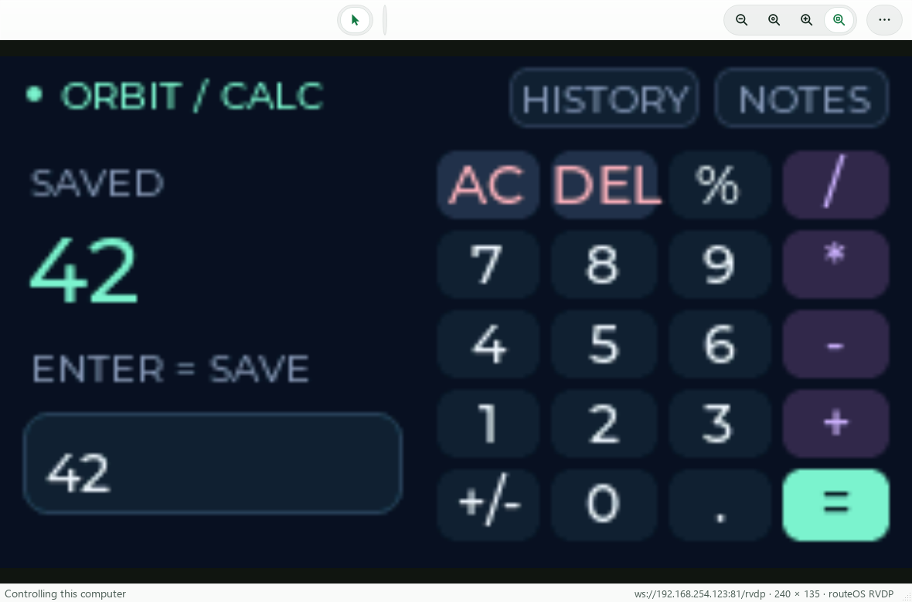

# Open routeOS in Arduino IDE

This guide covers the production sensor firmware and the separate Orbit Virtual
HMI. Opening or verifying a sketch does not replace the firmware on your ESP32.
Uploading does: the two targets are separate applications and do not run together.

## Is the Virtual HMI still running?

The HMI runs on the ESP32, not in a laptop terminal. Closing a browser,
iShareScreen, or serial monitor does not stop it. It starts again when the board
receives power, unless another sketch has been uploaded.

For the development board used in this project:

- Browser: <http://192.168.254.123/hmi>
- Health/status: <http://192.168.254.123/health>
- iShareScreen endpoint: `ws://192.168.254.123:81/rvdp`

The IP is assigned by the router and can change. Use the IP printed on serial at
115200 baud. Keep the board powered and the laptop on the same reachable network.
The headless ESP32 has no physical screen; EEZ/LVGL renders the pixels remotely.

**Use one viewer at a time.** Close the routeOS browser tab before connecting
iShareScreen, and disconnect iShareScreen before opening the browser. A second
viewer gets a busy error. If the browser is view-only, tick **Request pointer +
keyboard control**, reconnect, and click the screen before typing.



*Real ESP32 output in the native viewer, captured through Qt offscreen. This
image shows the HMI, not the Arduino IDE.*

## Choose the right source

| What you want | Source | Arduino entry point |
| --- | --- | --- |
| Production smart-bin firmware | `src/main.cpp` and sibling C++ files | Export a sketch as described below |
| Orbit calculator, history and notes | `virtual-hmi/src/`, `include/`, `web/` | Export the HMI sketch below |
| Edit the HMI layout visually | `virtual-hmi/eez/routeos-hmi.eez-project` | Open in EEZ Studio 0.29.0, not Arduino IDE |
| Existing v4 lid/docking sketch | Matching folder under `v4/` | Open that folder's matching `.ino` |

The repository root is a PlatformIO project. Arduino IDE does not import
`platformio.ini`, install its dependencies, run its web-asset generation script,
or translate its build flags automatically. Renaming `main.cpp` alone is not
enough for the HMI. The exporter below prepares the correct Arduino folder layout.

## Install the ESP32 board support

1. Install Arduino IDE 2 from [Arduino's software page](https://www.arduino.cc/en/software).
2. Open **File > Preferences** and add this **Additional Boards Manager URL**:

   ```text
   https://espressif.github.io/arduino-esp32/package_esp32_index.json
   ```

3. Open **Boards Manager**, search `esp32`, and select **esp32 by Espressif Systems**.
   Install **2.0.17** for the compatibility profile in this guide. It matches the
   Arduino core used by the pinned Virtual HMI PlatformIO environment. PlatformIO
   platform version `6.12.0` is a different version number, not an Arduino board
   package version. Do not select an ESP32-S3/C3 board for the original ESP32-WROOM.
4. Select **Tools > Board > esp32 > ESP32 Dev Module**.
5. Select the board's serial port under **Tools > Port**. On the tested Windows
   laptop it was **COM4**, a CP210x USB-to-UART bridge; verify yours rather than
   copying the old `/dev/cu.*` macOS paths from `platformio.ini`.

Use these board settings for the tested 4-MB, no-PSRAM ESP32:

| Setting | Production | Virtual HMI |
| --- | --- | --- |
| CPU Frequency | 240 MHz | 240 MHz |
| Flash Size | 4 MB | 4 MB |
| Partition Scheme | Huge APP (3MB No OTA/1MB SPIFFS) | Default 4MB with SPIFFS (1.2MB APP/1.5MB SPIFFS) |
| PSRAM | Disabled | Disabled |
| Upload Speed | 115200 | 115200 |
| Core Debug Level | None initially | None |
| Erase All Flash Before Sketch Upload | Disabled | Disabled |
| Serial Monitor baud | 115200 | 115200 |

Menu labels can vary slightly with the board package. The partition choice must
provide enough application space; keep the default partition scheme for HMI.

## Open the production source

From PowerShell in the repository root:

```powershell
cd C:\Users\yeems214\routeOS
.venv/Scripts/python.exe tools/export_arduino.py production
```

If you do not have this repository's Python environment, use `py -3` in place of
`.venv/Scripts/python.exe`; the exporter needs only the Python standard library.
Open this file using **File > Open** in Arduino IDE:

```text
C:\Users\yeems214\routeOS\build\arduino\routeOS\routeOS.ino
```

The exported layout is:

```text
routeOS/
  routeOS.ino       # This is the firmware's main.cpp (setup() and loop())
  config_manager.cpp/.h   # Each of these appears as its own tab
  ble_provisioning.cpp/.h
  ...                     # Remaining production .cpp/.h files
```

Top-level files show as tabs in the IDE, so you can read and edit the real code
directly. For the HMI, EEZ's generated C files live in `src/eez_generated/`
because Arduino only compiles subfolders under `src/`. They are not tabs; do not
hand-edit them (regenerate from EEZ Studio instead).

Install through **Library Manager**:

- **ArduinoJson by Benoit Blanchon**, version **7.x** (the repository requires
  `^7.0.0`; do not substitute the incompatible v6 API).
- **PubSubClient by Nick O'Leary**, version **2.8**.

WiFi, WebServer, DNSServer, Preferences, ArduinoOTA and ESP32 BLE come from the
ESP32 board package. Do not install an unrelated WiFi or ArduinoBLE replacement.
Press **Verify** to compile. Upload only when you intend to replace the current
Virtual HMI with production firmware.

The exporter makes a copy. Changes inside `build/arduino/` do not automatically
update the repository source. Copy intentional changes back to `src/` and review
them before committing. The exporter refuses an existing output folder to avoid
overwriting Arduino edits; use `--output build/arduino/routeOS_v2` for a new copy.

## Open the Orbit Virtual HMI source

Install these additional Library Manager dependencies:

- **lvgl**, exactly **8.4.0**; the EEZ export is not an LVGL 9 project.
- **WebSockets by Markus Sattler**, exactly **2.7.1**; not ArduinoWebsockets.

Export the interactive HMI sketch:

```powershell
.venv/Scripts/python.exe tools/export_arduino.py hmi --control
```

For a view-only firmware build, omit `--control`. Then open:

```text
C:\Users\yeems214\routeOS\build\arduino\routeOS_HMI\routeOS_HMI.ino
```

The exporter copies the EEZ-generated C files under `src/eez_generated/`, keeps
the custom application bindings separate, embeds the browser assets into
`src/web_assets.h`, copies `src/lv_conf.h`, and writes the required compiler flags
to **`build_opt.h`**. ESP32 core 2.0.17 reads that file as compiler options; it is
not a C header to include or edit as C++. Its `LV_CONF_PATH` is absolute: export
again if you move the sketch. Defining flags only in the `.ino` would not apply
them to separately compiled LVGL/WebSockets files.

**Wi-Fi credentials are deliberately not exported.** For a configured station
connection, create `src/wifi_secrets.h` inside the exported HMI sketch:

```c
#define HMI_WIFI_SSID "your-development-network"
#define HMI_WIFI_PASSWORD "your-password"
```

If the local ignored source header already exists, you can copy it without
printing the password:

```powershell
Copy-Item -LiteralPath virtual-hmi/include/wifi_secrets.h -Destination build/arduino/routeOS_HMI/src/wifi_secrets.h
```

Without that header the firmware starts a temporary access point and prints its
random password and URL on serial. Never commit credentials or distribute a
compiled image containing them. `build/` is ignored in this repository.

Press **Verify** first. Close Serial Monitor before an upload. After uploading,
open Serial Monitor at **115200**, read the IP, and open `/hmi` in a browser or
connect iShareScreen to `ws://DEVICE_IP:81/rvdp`.

For layout changes, build the `.eez-project` with EEZ Studio, then export a fresh
Arduino sketch. Do not hand-edit EEZ-generated files. Details and keyboard
shortcuts are in the [Virtual HMI guide](../virtual-hmi/README.md).

## Existing v4 sketches

Folders such as `v4/lid-version/` and `v4/docking-version/` already contain a
matching `.ino`; open that file directly. Use each variant's README and
`platformio.ini` for its dependencies. ToF variants additionally require the
Pololu **VL53L0X** library. Compile one variant at a time; do not combine multiple
variant folders or their duplicate `src/*.ino` copies into one sketch.

## Troubleshooting

| Symptom | What to check |
| --- | --- |
| Browser stuck at Connecting, no complete batches | Reload `/hmi` to fetch the current viewer. Close other HMI viewers. Use the recovery-fixed firmware/viewer; a reachable `/health` alone does not prove a complete frame has arrived. |
| "routeOS display is busy" in the browser or iShareScreen | Another viewer already holds the single slot. Close the other browser tab or iShareScreen session, then reconnect. (Older firmware/viewers showed only a timeout.) |
| iShareScreen dialog still says only "Request pointer control" | You are running an older executable. Rebuild with `./packaging/build.ps1 -DistDir dist/orbit-fixed` and run that copy; the newer label reads "pointer + keyboard control". |
| Black canvas after firmware update | Reload the page; an existing tab can still run the earlier JavaScript. |
| No COM port | Check the data-capable USB cable, board power and CP210x driver in Device Manager. |
| Port busy / access denied on upload | Close Serial Monitor and other serial tools. Browser and iShareScreen use Wi-Fi, not COM4. |
| `lvgl.h` or `WebSocketsServer.h` missing | Install the exact library and version above in Arduino's Library Manager; PlatformIO's `.pio` libraries are separate. |
| `web_assets.h` missing | Use the HMI exporter; Arduino does not run PlatformIO's embedding hook. |
| Font/config errors, blank or wrong colors | Keep `build_opt.h` and exported `lv_conf.h`; use LVGL 8.4.0 and regenerate if the sketch moved. |
| Sketch too large | Select the target's partition scheme; production uses Huge APP. |
| Multiple definitions of `setup()` or `loop()` | Keep the exported `.ino` stub; the real definitions already live in `src/main.cpp`. |

## Validation and reference workflow

Both exported sketches were **compiled** with Arduino's own toolchain
(`arduino-cli` 1.5.1, the engine inside Arduino IDE 2) using esp32 core **2.0.17**,
ArduinoJson 7.4.3, PubSubClient 2.8, lvgl 8.4.0 and WebSockets 2.7.1, in an
isolated scratch install that did not touch your IDE settings:

| Sketch | Board / partition | Result |
| --- | --- | --- |
| Production (`routeOS`) | ESP32 Dev Module, Huge APP | Compiles; 1,674,053 bytes flash (53%), 62,812 bytes RAM |
| Orbit HMI (`routeOS_HMI`, `--control`) | ESP32 Dev Module, default partitions | Compiles; 1,058,425 bytes flash (80%), 104,744 bytes RAM |

The HMI's 104,744-byte RAM figure is identical to the PlatformIO build, which shows
`build_opt.h` is being applied. These were compile-only checks: the Arduino-built
images were **not uploaded** to the board. The firmware actually running on the
ESP32 was built and flashed with PlatformIO.

**Windows path length:** the toolchain failed with "The filename or extension is
too long" when the sketch, board data and build folder sat under a deep path. If
you see that, enable Windows long paths or keep the Arduino data/build folders
near the drive root (for example `C:\ard`). Arduino IDE's default locations are
normally short enough.

Use the pinned PlatformIO environment for the hardware-validated HMI build:

```powershell
.venv/Scripts/python.exe -m platformio run --project-dir virtual-hmi -e virtual-hmi-control
# Only when intentionally uploading:
.venv/Scripts/python.exe -m platformio run --project-dir virtual-hmi -e virtual-hmi-control -t upload --upload-port COM4
```

The exporter never uploads, changes production source or copies Wi-Fi secrets.
Keep a verified original flash backup before switching firmware; the original
lab board backup is stored locally under ignored `build/hmi-backup/`.

Official references: [Arduino sketch layout](https://docs.arduino.cc/arduino-cli/sketch-specification),
[Espressif board installation](https://docs.espressif.com/projects/arduino-esp32/en/latest/installing.html),
and [ESP32 2.0.17 build options](https://github.com/espressif/arduino-esp32/blob/2.0.17/platform.txt).
