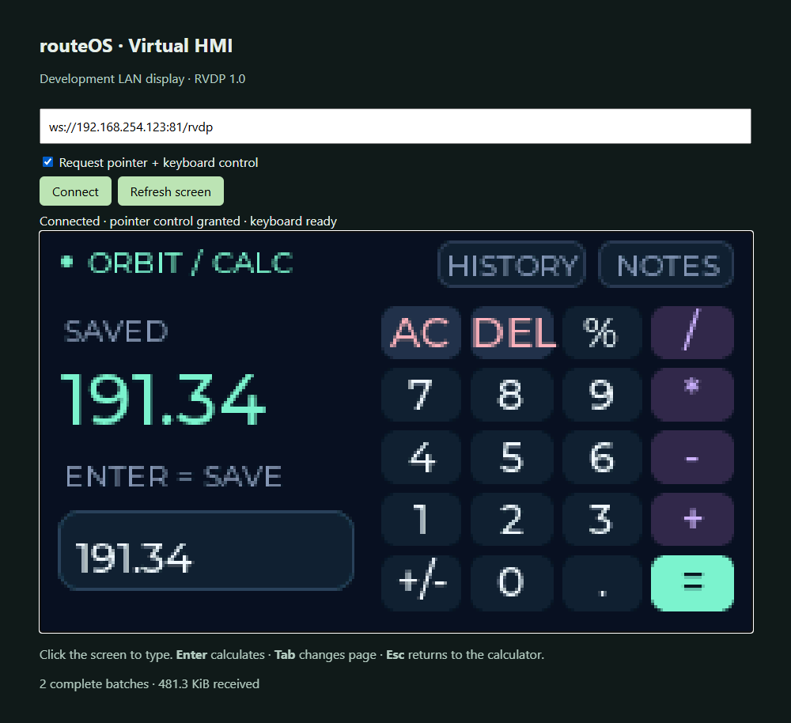

# Virtual HMI implementation record

## Screenshots from the physical ESP32

These show the **real EEZ-generated LVGL UI running on COM4's ESP32**, not the
protocol simulator. Captured on 22 October 2026 at 240×135 native resolution;
both viewers scale those device pixels to fit their windows.

*Twenty-button calculator with live evaluation and physical keyboard input.
The browser surrounds the ESP32-rendered canvas with connection controls.*

*Three recent calculations; tap a result to reuse it.*

*Notes accept both the LVGL QWERTY keyboard and the laptop keyboard.*

*Live ESP32 pixels captured through Qt's offscreen platform in the actual native
session window. Zoom, fit, refresh and reconnect remain available.*

The screen layout is editable in
[`routeos-hmi.eez-project`](../virtual-hmi/eez/routeos-hmi.eez-project). Its generated
source is in `virtual-hmi/src/eez_generated/`; custom bindings are separate.

## Orbit upgrade - 22 October 2026

The counter demo has been replaced by a three-page EEZ Studio project: Calculator,
History, and Notes. The project builds with EEZ Studio 0.29.0, LVGL 8.4.0, Flow
disabled. All generated C/headers are EEZ output; bindings and the bounded C++
expression parser live separately. Production routeOS source is untouched.

The calculator has 20 buttons, live preview, precedence, parentheses, percent,
powers, scientific notation and explicit invalid-expression/divide-by-zero
handling. Expressions have a 64-character limit. Enter or equals records one of
three history entries. A 128-character scratchpad has an LVGL on-screen keyboard.
History and notes are volatile and reset at reboot.

Click the remote screen to focus physical typing. Enter evaluates on Calculator
and inserts a newline on Notes. Tab/PageDown cycles pages; PageUp goes backward;
Escape returns to Calculator, or clears it when already there. Backspace, Delete,
Left/Right and Home/End edit text. This profile supports printable ASCII; Unicode
and modifier chords are outside the current wire contract.

RVDP 1.1 adds negotiated keyboard capability and a five-byte KEY payload. Legacy
1.0 packets and golden vectors are preserved; older viewers stay pointer-only.
Both firmware opt-in and an explicit viewer request/grant gate input. Key events
use a separate connection epoch so visual resync does not discard typing. A
bounded 32-event queue disconnects on overflow rather than losing text silently.
The default source firmware and viewer still start view-only.

Validation for this upgrade:

- Actual ESP32/Edge acceptance: nine arithmetic cases including `2^3^2 = 512`,
  `-2^2 = -4`, `2^-2 = 0.25`, percentage, decimal precision and invalid results;
  physical typing and newline insertion, all three pages, the touch calculator
  keypad, and the actual LVGL QWERTY keyboard with physical Backspace editing.
- Actual iShareScreen Qt keyboard events: `21*2 = 42`, page navigation and Notes
  editing. Screenshots are captured after redraw settles, rather than immediately
  after the health endpoint changes application state.
- iShareScreen full suite: **332 passed**. Browser codec: **10 passed**; canonical
  Python codec: **10 passed**. Canonical and native Python codecs are byte-identical.
- Both isolated firmware environments compile. The interactive image is flashed
  to COM4. LVGL still uses 32 KiB, the draw strip 7,680 bytes and the ten-slot tile
  queue approximately 77 KiB; no full framebuffer or PSRAM was added.
- Final Orbit image: **20/20** legacy 1.0 reconnects reconstructed a full screen.
  Median first complete screen was **0.480 seconds**, slowest **0.754 seconds**;
  the drop counter stayed unchanged through this test. The device rejected
  unauthorized POINTER and 1.1 KEY packets, and an oversized
  claimed payload. Report: ignored `build/orbit-reconnect.json`. End heap was
  **104,428 bytes**, minimum **79,604**, largest block **34,804**, queue empty,
  PSRAM **0**. Rapid reconnect/typing recovery can drop damaged batches; full
  resync recovers them. This is not a new long-duration soak.
- Interactive image uses **104,744 bytes static RAM** and **1,044,101 bytes flash**.
- Fresh Desktop and Liquid Glass apps in `iShareScreen/dist/orbit/` passed frozen
  startup/Qt/dependency smoke checks. Existing running binaries were left alone.

The measurements and counter tests described below are the earlier
counter milestone. They are retained as historical evidence, not a claim that
its 180-second streaming soak was repeated with the new application.

## Decision record — 2026-10-22

The two supplied plans are feasible for a development prototype on an original
ESP32 at 240×135. They specify incompatible wire formats: RHMI uses little endian,
whereas RVDP uses big endian. This implementation selects **RVDP 1.0 for both the
browser and native viewer**; there is one wire specification in
`protocol/rvdp-v1.md`.

- Preserve all existing production source/build environments. Use a standalone
  `virtual-hmi/platformio.ini` and its own source directory.
- Pin PlatformIO Espressif32 6.12.0 (Arduino-ESP32 2.0.17 / ESP-IDF 4.4.7), LVGL
  8.4.0, and arduinoWebSockets 2.7.1. Do not mix LVGL 9 APIs with this profile.
- 240×135 RGB565, a single 240×16 draw buffer (7,680 bytes), no device framebuffer.
  Bounded transport storage; drop an entire damaged batch and request a full redraw.
- Only the UI task touches LVGL. The network task copies input into a queue; flush
  copies pixels into owned packets before signalling flush-ready.
- iShareScreen uses Qt threads and `QImage`, so add a protocol-specific controller
  with the same small signal/input interface. Preserve the RFB implementation and
  reuse its session window, zoom, and pointer coordinate mapping.
- Remote input is off by default. A lab firmware flag and viewer request must both
  permit control. No keyboard, clipboard, audio, or Mac shortcuts for RVDP.
- User requested EEZ output rather than a hand-written substitute. Created a
  native LVGL project from EEZ's official template and exported it with **EEZ
  Studio 0.29.0**. Flow is disabled; generated files stay untouched and application
  bindings live in `ui_bindings.cpp`. Both `ui_init()` and `ui_tick()` are used.
- iShareScreen is AGPL-3.0-or-later. This work stays in its source repository;
  proprietary distribution/legal clearance is outside this lab prototype.

## Baseline

- routeOS: clean `main`; production is monolithic v4.0.0, with older helper modules.
- iShareScreen: clean `liquid-glass`, `88b0bcd`; **297 tests passed** before changes.
- CP210x USB adapter on COM4; ESP32-D0WD-V3 revision 3.1, 4-MiB SPI flash,
  no PSRAM. The module has no native USB host; none is needed for this HMI.
- PlatformIO was absent; installed in ignored routeOS `.venv` for reproducible CLI use.
- Existing `webui` environment refers to absent `EcoRouteBin` and uses an
  environment-local `src_dir`; preserve and report baseline behavior separately.

## Running acceptance checklist

- [x] Inspect both plans, repositories, and iShareScreen baseline tests.
- [x] Freeze transport byte order, display size, LVGL major, integration seam.
- [x] Protocol fixtures, malformed-input tests, and deterministic simulator.
- [x] Native adapter, saved connection mode, capability-aware controls.
- [x] Isolated firmware compile and browser viewer.
- [x] Chip/flash inventory, original firmware backup, baseline firmware builds.
- [x] Hardware logs, full-refresh/reconnect/input validation and memory measurements.
- [x] Native EEZ project and unmodified EEZ-generated LVGL 8.4 UI.
- [x] 100-session reconnect run and short continuous stream (results below).
- [ ] 60-minute continuous hardware soak, 320×240 and TLS profiling.

Compile, simulated integration, physical flash, UI validation, and soak results
must be recorded separately. An unchecked item is not verified.

## Verified results

### Builds and host tests

- Production root targets `esp32dev`, `webui`, `tc2`, and `tof-test`: all compile.
  Root platform is unpinned and resolved Espressif32 8.0.0 / Arduino 3.3.12.
  Existing `webui` warning is significant: its invalid environment-local `src_dir`
  is ignored, so it builds production source, not the absent legacy directory.
  No production files or target definitions were changed to hide that issue.
- Isolated `virtual-hmi-control`: pinned Espressif32 6.12.0 / Arduino 2.0.17 /
  ESP-IDF 4.4.7 / LVGL 8.4.0 / WebSockets 2.7.1. Compiles and flashes successfully.
  The default view-only `virtual-hmi` target also compiles. Its image uses
  103,516 bytes static RAM and 964,617 bytes flash (73.6% of the default app slot).
- EEZ 0.29.0 `--build-project`: **no errors or warnings**, actual generated C and
  headers checked in with the editable `.eez-project`.
- iShareScreen: **324 tests passed** (297 baseline + 27 RVDP, including automatic
  reconnect and saved-library roundtrip). One existing
  Launchpad timing test was flaky during concurrent compilation; isolated retry
  and a subsequent full run both passed. RFB source and base session code unchanged.
- Browser codec: **9 Node tests passed**, including golden RGB pixels and malformed
  packets. Canonical Python codec: **10 tests passed**, including 512 deterministic
  malformed buffers. The two Python wire codec copies have matching SHA256 hashes.
- Real Edge headless against simulator: canvas rendering, control request,
  scaled button click, refresh, reload/reconnect; no JS errors. Native Qt window
  also renders, sends pointer input, and refreshes against that simulator.

### Physical board

- Original 4,194,304-byte image saved at ignored
  `build/hmi-backup/original-COM4-20261022.bin`.
- SHA256: `04192d8f7612586bcdd0479f7338a55d3eaf0357a5cb8c1041c2ce28fc7cd80a`.
- **Whole-image verification against physical flash passed before writing.**
  Long USB reads were unreliable; chunked reads plus verification produced a
  complete backup. Backup/NVS contents and Wi-Fi header are never committed.
- Prototype flashed on COM4. Wi-Fi joined supplied development network and got
  `192.168.254.123`; HTTP `/hmi` and `/health`, WebSocket `:81/rvdp` accessible.
- Edge browser renders actual EEZ screen, changes counter by a scaled click,
  refreshes and reconnects on reload. Serial confirms `EEZ button click counter=1`.
- iShareScreen's real `RVDPSessionWindow` renders the physical device as 240×135,
  receives a control grant, sends a click, and refreshes a complete screen.
- Hardware screenshots are retained under `docs/screenshots/` and embedded above;
  temporary originals stay in ignored `build/`. Serial logs: `build/hmi-serial.log` and
  `build/hmi-stress-serial.log`.

### Measured memory and implementation limits

At boot (before Wi-Fi/LVGL allocations), heap **250,148 bytes**, largest block
**110,580 bytes**. After UI/Wi-Fi starts: approximately **112 KB free**, largest
block **34,804 bytes**, PSRAM **0**. During viewer/reconnect testing, free heap
is typically **102–108 KB**, minimum observed approximately **81 KB**. Task stack
watermarks exceed 5 KB in measured runs. `/health` exposes current measurements.

The initial all-static tile queue exceeded the ESP32's mapped static DRAM region,
even though total SRAM was sufficient. The ten-slot queue is now allocated once
before Wi-Fi using a fixed-capacity FreeRTOS queue (~77 KiB). LVGL's 32-KiB pool,
7,680-byte draw strip, and bounded input state remain separate. No full device
framebuffer is retained. Larger resolutions require a new queue/heap budget;
320×240 is **not** enabled by changing two constants.

Rapid reconnect testing exposed partial redraws preceding a new full snapshot
while old queue entries drained. The UI now suppresses those partial updates until
the new generation's full render completes. Overflow omits a damaged batch's end
marker, drains stale generations, then invalidates LVGL for a complete repaint;
clients stage pixels and request resync rather than displaying incomplete batches.

The WebSockets dependency bounds receive allocations at **15 KiB** before the
application enforces its stricter **1-KiB client message** cap. The library does
not honor a command-line override for its ESP32 receive cap. This is documented
rather than claiming allocations are limited to 1 KiB throughout the stack.

### Reconnect and short soak report

Actual board test, final generation gate enabled (`build/hmi-stress.json`):

- **100/100** new connections reconstructed a complete 240×135 screen.
- Median first complete screen: **0.575 seconds**; slowest **3.668 seconds**.
- View-only session rejected a deliberately unauthorized POINTER packet.
- Invalid packet claiming a `0xffffffff` payload length was rejected.
- **180 seconds continuous streaming**, **180 complete batches**, no disconnect,
  reset, parsing failure or permanent corruption during this continuous segment.
- Free heap before/after run: **109,864 → 109,364 bytes** (500-byte difference,
  within live network allocation variation). Largest block stayed **34,804 bytes**;
  minimum heap **81,920 bytes**. Queue empty at the end.
- **25 queue drops** under rapid reconnect turnover. Every requested session
  subsequently recovered a complete snapshot; the implementation does not claim
  lossless delivery during congestion. During the subsequent continuous segment,
  the drop counter stayed stable. Final bytes sent: **11,450,648**.

Repeated browser smoke runs exposed an intermittent reload that left scripts
uninitialized. The firmware now embeds both scripts into its `/hmi` response and
disables caching, removing separate asset requests during reconnect. The final
image passed **10 consecutive browser reloads**, including the complete-screen
gate, and a subsequent native window/control/refresh test. The native startup
generation fix preceded the 100-session report above. These short tests do not
substitute for a longer network-interruption/throttled-client test.

### Remaining gates

- Long hardware soak (60+ minutes), Wi-Fi AP interruption/recovery, deliberately
  throttled clients, and authenticated TLS/gateway profiling remain unverified.
- No authentication suitable for production. Flash image is the explicitly
  interactive lab target; view-only is the default source build and viewer mode.
- No BLE/MQTT/sensor code is running in this isolated prototype. Integrating the
  HMI into production firmware requires a fresh combined memory/performance gate.
- Both iShareScreen packaging specs include `aiohttp`. Fresh **Desktop** and
  **Liquid Glass** executables under ignored `iShareScreen/dist/rvdp/` passed
  startup/Qt/dependency smoke checks. The running old Liquid Glass executable was
  left alone. Build tooling accepts `-DistDir dist/rvdp`; smoke tooling accepts
  `--dist-dir dist/rvdp`. Existing binaries have `-before-RVDP` backup copies.
- Do not promote this prototype to routeOS Core or a customer deployment yet.

## References consulted

- https://docs.lvgl.io/8.4/porting/display.html
- https://docs.lvgl.io/8.4/porting/indev.html
- https://github.com/Links2004/arduinoWebSockets
- https://docs.espressif.com/projects/arduino-esp32/en/latest/api/wifi.html
